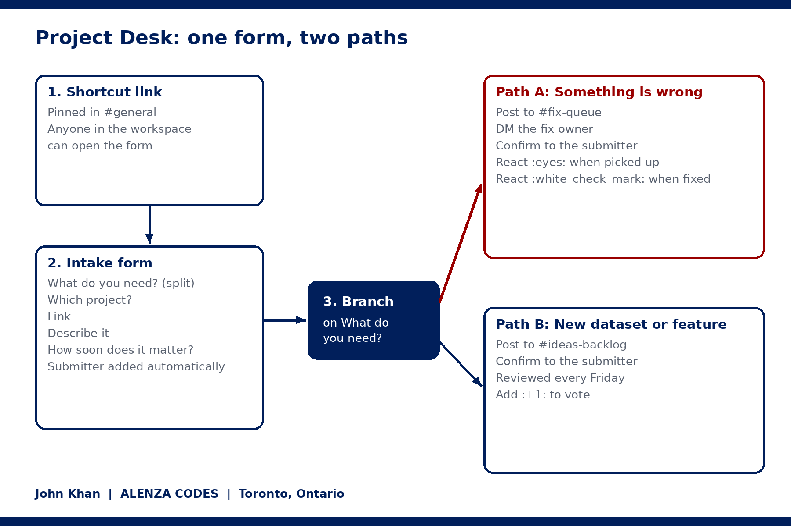

# Project Desk: a Slack Intake Workflow

One Slack form takes every request about my public tools and datasets and sends it to the right place with no forwarding by hand. Built in Slack Workflow Builder in a developer sandbox.

## The split
One dropdown, two answers:
1. **Something is wrong in a live tool or dataset**: posts to #fix-queue, DMs the fix owner, confirms to the sender
2. **I want a new dataset or feature**: posts to #ideas-backlog for a Friday review, confirms to the sender

## The form
What do you need? / Which project? / Link / Describe it / How soon does it matter? (the sender is added automatically)

Full field list, message text for each path, and the end to end test plan: [workflow-spec.md](workflow-spec.md)

## Next workflows
1. A Friday digest of the week's ideas
2. A note to the reporter when a fix is marked done

Built by John Khan, ALENZA CODES, Toronto, Ontario.
